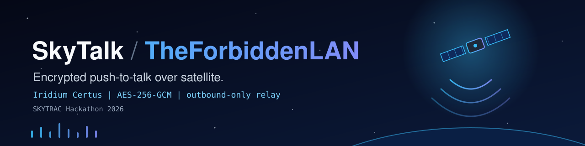
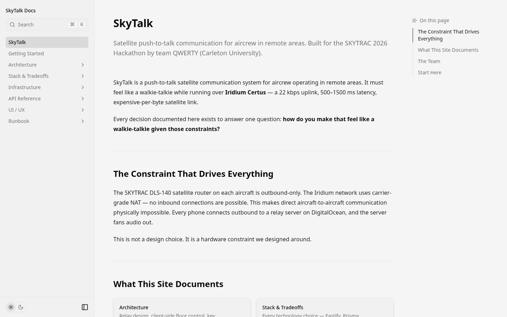
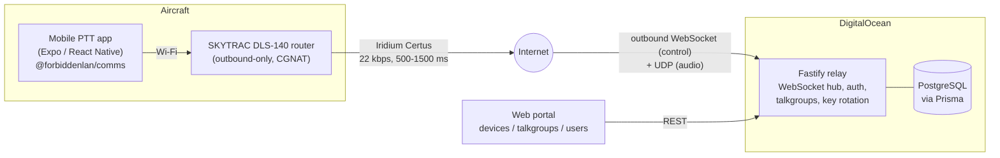
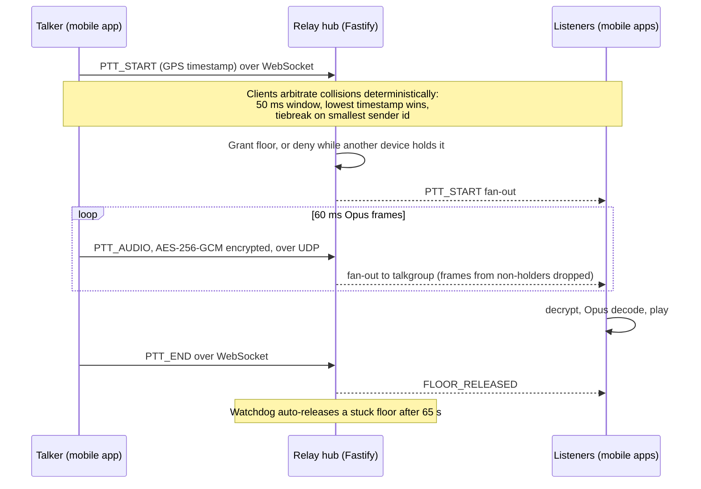

<p align="center">
  
</p>

<p align="center">
  
  
  
  
  
  
  
  <br>
  
  <a href="https://the-forbidden-lan-docs.vercel.app/docs"></a>
</p>

# SkyTalk (TheForbiddenLAN)

**Walkie-talkie style push-to-talk for aircrew in remote areas, running over an Iridium Certus satellite link.** Audio is encrypted with AES-256-GCM, travels through an outbound-only relay, and is built to feel live on a link with 500-1500 ms latency.

Built for the **SKYTRAC Hackathon 2026** by a four-person team. Full documentation: **[the-forbidden-lan-docs.vercel.app/docs](https://the-forbidden-lan-docs.vercel.app/docs)**

<p align="center">
  <a href=".github/assets/skytalk-demo.mp4"></a>
  <br>
  <sub>Silent preview. Click it for the full video with sound (MP4).</sub>
</p>

<p align="center">
  <a href="https://the-forbidden-lan-docs.vercel.app/docs"></a>
</p>

## The problem

The SKYTRAC DLS-140 router on each aircraft connects phones over Wi-Fi and reaches the world through Iridium Certus. That link is hostile to real-time voice:

| Constraint | Reality | What it forces |
|---|---|---|
| Bandwidth | ~22 kbps uplink | Small Opus frames, minimal framing overhead |
| Latency | 500-1500 ms round trip | No chatty protocols; no waiting on acknowledgements per frame |
| Carrier-grade NAT | DLS-140 is outbound-only, nothing can dial in | No peer-to-peer. Every client connects *out* to a relay |
| Packet loss | Satellite handoffs drop packets | TCP head-of-line blocking turns voice into "voicemail bursts" |

The architecture follows from those constraints. See [`docs/ADR-001-udp-audio-transport.md`](docs/ADR-001-udp-audio-transport.md) for the transport decision.

## Architecture



Everything on the aircraft side connects **outbound** to the relay, which is what lets the system work behind the carrier-grade NAT. The relay authenticates clients, then fans messages out by talkgroup. Encrypted audio passes through it as opaque blobs.

### Push-to-talk flow

Reconstructed from [`docs/sequence-ptt.md`](docs/sequence-ptt.md), [`ADR-001`](docs/ADR-001-udp-audio-transport.md), `packages/comms/src/FloorControl.ts` and `packages/server/src/ws/hub.ts`.



Control messages (floor, join/leave, presence, text) stay on reliable WebSocket; audio frames use UDP so a lost packet is concealed rather than stalling the stream.

## Features

- **Push-to-talk voice** with 60 ms Opus frames over a satellite-constrained link
- **Deterministic floor control** in the client comms layer (50 ms collision window, timestamp then sender-id tiebreak), plus a server-side single-floor-holder check with walk-on prevention and an auto-release watchdog
- **End-to-end encrypted audio** (AES-256-GCM); the relay cannot decrypt it
- **Outbound-only relay** on DigitalOcean: WebSocket hub for control, UDP for audio
- **Auto-reconnect** with exponential backoff (1 s doubling to a 30 s cap, unlimited retries) for satellite drops
- **DLS-140 integration**: REST API client and GPS polling
- **Talkgroups, devices, users and key rotation** managed through a Fastify REST API backed by PostgreSQL (Prisma)
- **Admin web portal** pages for devices, talkgroups and users (`packages/portal`)
- **Docs site** (Fumadocs) covering architecture, API reference and runbooks

## Security

- Audio chunks are encrypted client-side with **AES-256-GCM** (random 12-byte IV per chunk, prepended to the ciphertext) using the Web Crypto API (`packages/comms/src/Encryption.ts`).
- The relay forwards encrypted blobs only.
- The documented key design derives each talkgroup key on-device as `KDF(master_secret, talkgroup_id, rotation_counter)`, so derived keys never cross the network and rotation is a counter bump. See [Key Management](packages/docs/content/docs/architecture/key-management.mdx).
- Auth uses JWTs (`@fastify/jwt`) and bcrypt-hashed passwords.

## Monorepo structure

```
packages/
  comms/    @forbiddenlan/comms   DLS-140 client, relay socket, UDP socket, audio pipeline,
                                  encryption, floor control, GPS poller
  server/   @forbiddenlan/server  Fastify relay: REST routes, WebSocket/UDP hub, Prisma schema,
                                  key rotation, Dockerfile + docker-compose
  mobile/   @forbiddenlan/mobile  Expo / React Native PTT app
  portal/   @forbiddenlan/portal  Web portal pages (Dashboard, Devices, Talkgroups, Users)
  docs/                           Fumadocs (Next.js) documentation site
docs/       Engineering notes, ADRs, DLS-140 reference material
e2e/        Playwright end-to-end tests
scripts/    Local bootstrap (setup-local.sh)
```

## Getting started

Requires Node 20+. The repo pins `pnpm@10.23.0` through the `packageManager` field; Corepack installs it for you.

```sh
corepack enable
pnpm install
```

Or use the one-command bootstrap, which also builds comms, generates the Prisma client, seeds `.env` files and checks the Android toolchain (see [`docs/LOCAL_DEV_BOOTSTRAP.md`](docs/LOCAL_DEV_BOOTSTRAP.md)):

```sh
pnpm setup:local
```

### Configure

```sh
cp .env.example .env   # then fill in values; the file lists the variables each package reads
```

### Run

```sh
pnpm dev:server    # Fastify relay (tsx watch), listens on PORT (default 3000)
pnpm dev:mobile    # mobile app via Nx
pnpm dev:admin     # Expo web target (browser)
pnpm dev:docs      # documentation site (Fumadocs / Next.js)
./run-android.sh   # start emulator and build the Android app
```

### Server with Docker

`packages/server/docker-compose.yml` runs PostgreSQL 16 plus the server (ports `3000/tcp` and `3000/udp`). The entrypoint runs `prisma db push` and then starts the server. Provide `POSTGRES_USER`, `POSTGRES_PASSWORD`, `POSTGRES_DB` and `JWT_SECRET` in the environment:

```sh
cd packages/server
docker compose up --build
```

### Other commands

```sh
pnpm build:comms   # build the shared comms library (currently fails on a tsconfig rootDir error)
pnpm build:all     # build everything
pnpm test:all      # unit tests via Nx
pnpm test:e2e      # Playwright end-to-end tests
pnpm lint:all      # lint via Nx
pnpm nx graph      # dependency graph
```

More: [`docs/MOBILE_SETUP_TROUBLESHOOTING.md`](docs/MOBILE_SETUP_TROUBLESHOOTING.md), [`docs/UI_DEVELOPMENT_GUIDE.md`](docs/UI_DEVELOPMENT_GUIDE.md).

## Team

SKYTRAC Hackathon 2026, team QWERTY (Carleton University).

| Who | Owned |
|---|---|
| **Saim Hashmi** ([@anakafeel](https://github.com/anakafeel)) | `@forbiddenlan/comms`: DLS-140 API client, WebSocket relay client, audio pipeline, floor control, GPS polling |
| **Shrikar Vempati** ("Shri") | `@forbiddenlan/server`: Fastify relay on DigitalOcean, auth, talkgroup management, WebSocket hub, key rotation |
| **Maisam** and **Annie** ([@AnnieR15](https://github.com/AnnieR15)) | `@forbiddenlan/mobile` (PTT app) and `@forbiddenlan/portal` (web portal) |

## Documentation

Architecture, floor control, key management, API reference, deployment and troubleshooting live on the docs site: **https://the-forbidden-lan-docs.vercel.app/docs** (source in `packages/docs/content/docs`).

## License

See [LICENSE](LICENSE).
